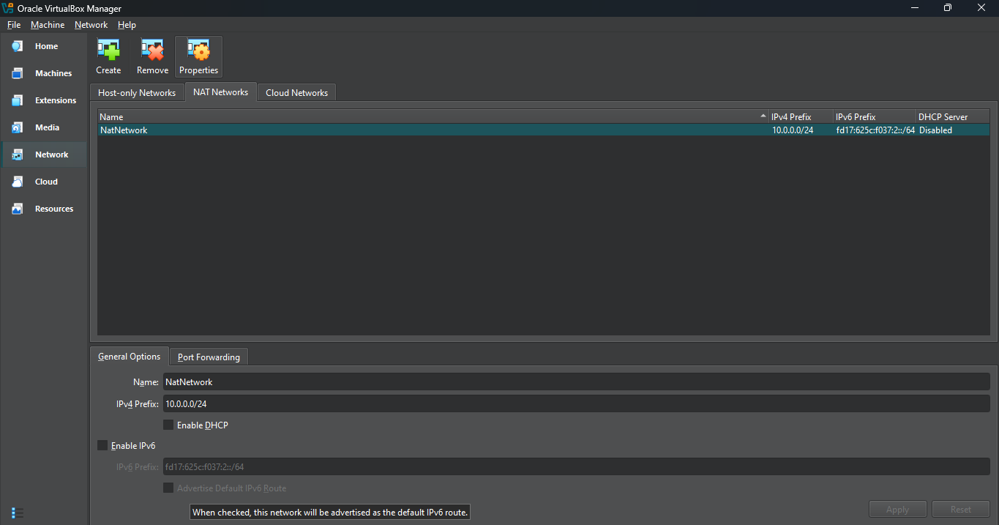
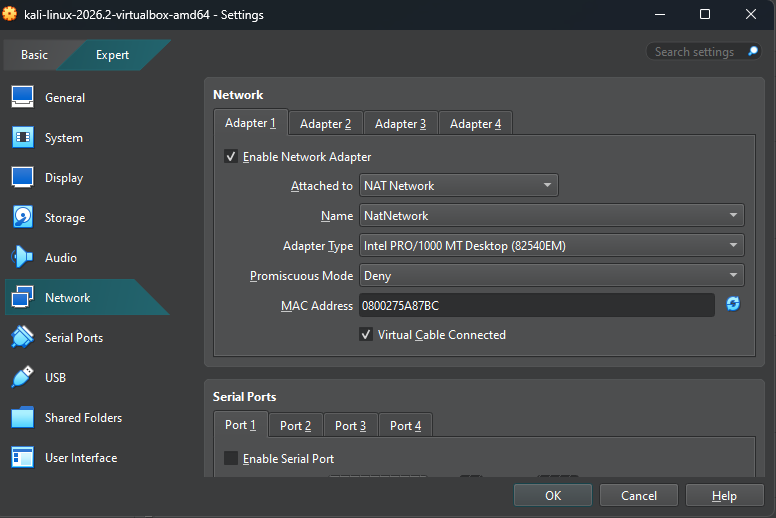
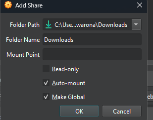
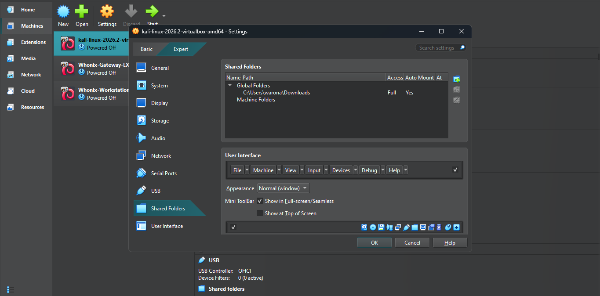
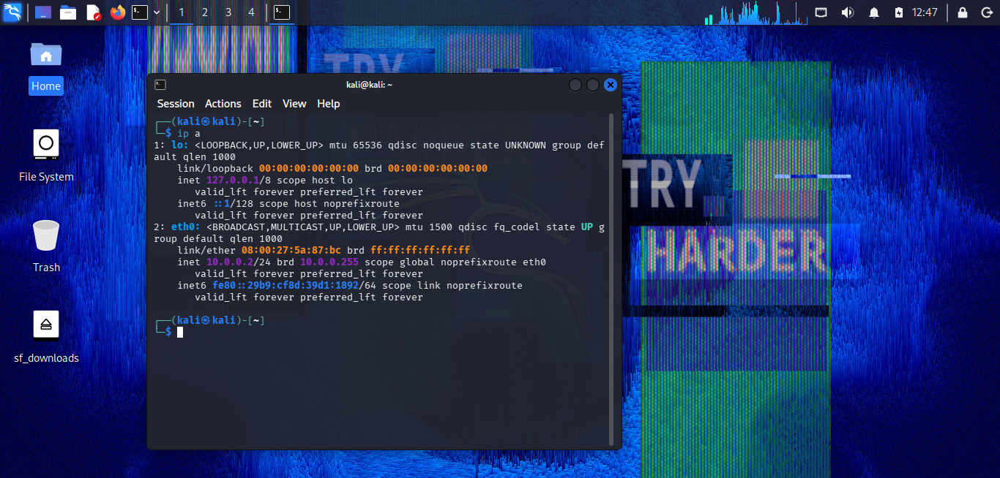
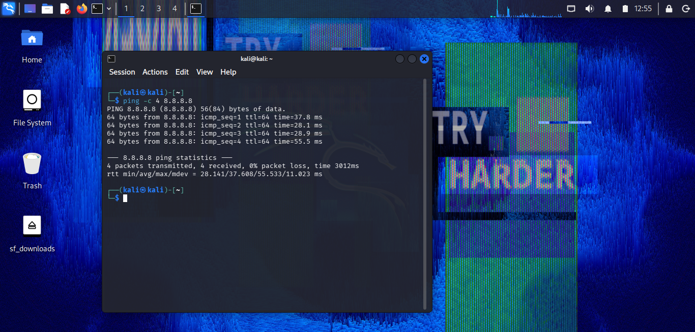
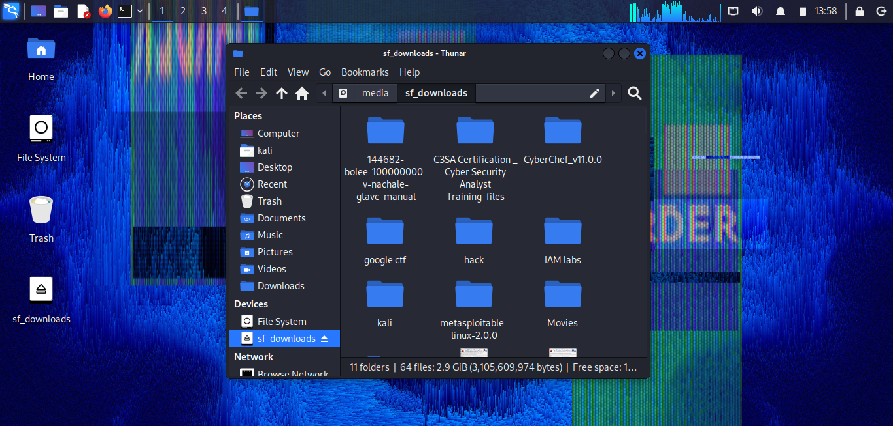
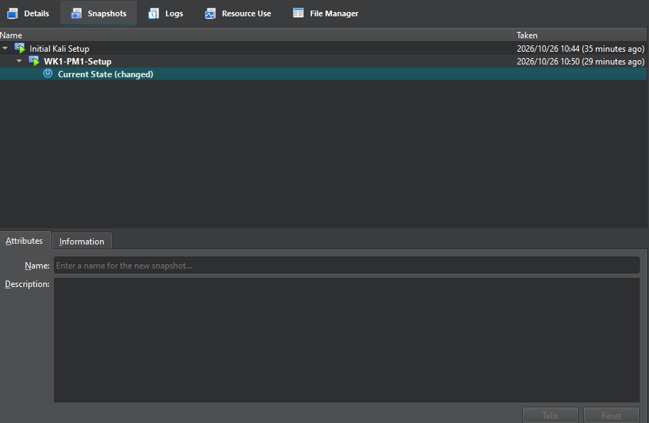

# 🔐 Cybersecurity Lab Environment Setup

An isolated virtual lab for practising penetration testing and ethical hacking.

---

## 📌 What This Project Is About

This project builds a hands-on cybersecurity laboratory using VirtualBox and Kali Linux.

The goal is to have a safe, private space where I can run security tools, scan networks, test vulnerabilities, and experiment with attack techniques without putting any real system at risk.

Everything runs on a private NAT Network inside my laptop, so machines can talk to each other while staying separated from my home network.

---

## 🎯 Goals

By the end of this project I wanted to:

- Get VirtualBox running as my hypervisor.
- Bring Kali Linux into the environment as my attack machine.
- Build a private `10.0.0.0/24` network for all lab machines.
- Give Kali a fixed IP address instead of relying on DHCP.
- Connect the host and guest properly through clipboard, file transfer, and a shared folder.
- Prove the lab has working internet and DNS.
- Save a clean snapshot before touching anything risky.
- Write everything down so future projects have a reference.

---

## 🛡️ Why Build It This Way

A lab like this lets me practise skills that would otherwise be illegal or dangerous to try on live systems:

- Network discovery and mapping.
- Port scanning.
- Finding weak services.
- Capturing and reading traffic.
- Testing web applications.
- Learning how exploits actually behave.

> ⚠️ **Note:** Everything in this lab stays on my own hardware. I only ever test machines I set up myself.

---

## 🏗️ How the Lab Is Put Together

| Piece | Role |
|---|---|
| Windows 10 | Physical machine everything runs on |
| VirtualBox | Runs the virtual machines |
| NatNetwork | Private `10.0.0.0/24` network joining all VMs |
| Kali Linux | My attacker box |

Target machines, including Windows Server, older Windows versions, and Android, will be added later on the same network.

---

## ⚙️ Final Configuration

| Item | Value |
|---|---|
| Host OS | Windows 10 |
| Hypervisor | VirtualBox 7.x |
| Guest OS | Kali Linux 2026.2 |
| Network type | NAT Network |
| Network name | `NatNetwork` |
| Network range | `10.0.0.0/24` |
| Kali address | `10.0.0.2/24` |
| Gateway | `10.0.0.1` |
| DNS | `8.8.8.8` |
| Shared folder | `C:\Users\warona\Downloads\` → `/media/sf_downloads` |
| Clipboard | Bidirectional |
| Drag-and-drop | Bidirectional |
| Free addresses for future VMs | `10.0.0.3–10.0.0.99` |

---

## 🪜 How I Built It

### Step 1 — Getting 7-Zip Ready

Kali ships its pre-built VM image compressed, so I needed an extractor that handles `.7z`. That's what 7-Zip does here.

**Download:** https://7-zip.org/download.html

---

### Step 2 — Installing VirtualBox

VirtualBox became the foundation everything else sits on top of.

**Download:** https://virtualbox.org/wiki/Downloads

---

### Step 3 — Building the Private Network

Inside VirtualBox, I opened Network Manager and created a NAT Network rather than using the default single-machine NAT mode.

**Settings I used:**

- **Name:** `NatNetwork`
- **IPv4 Prefix:** `10.0.0.0/24`
- **DHCP:** Off. I want to control addresses by hand.
- **IPv6:** Off

Regular NAT gives one VM its own path out to the internet. A NAT Network lets several VMs communicate with one another and reach the internet, which is exactly what a multi-machine lab needs.



---

### Step 4 — Bringing Kali Into VirtualBox

I grabbed the pre-built VirtualBox image straight from Kali's site and imported it, then pointed its first adapter at my new network.

**Adapter 1:**

- Attached to: NAT Network
- Network: NatNetwork
- Adapter Type: Intel PRO/1000 MT Desktop
- Cable Connected: Ticked



---

### Step 5 — Connecting Host and Guest

Three settings make working between Windows and Kali easier:

- **Shared Clipboard:** Bidirectional, so I can copy text both ways.
- **Drag-and-Drop:** Bidirectional for quick file transfers.
- **Shared Folder:** Pointing at my Windows Downloads folder, auto-mounted and permanent.

Without these, you're stuck retyping commands or moving files through less convenient methods.





---

### Step 6 — Giving Kali a Fixed Address

DHCP was off, so I assigned the address manually through NetworkManager.

```bash
sudo nmcli connection modify "Wired connection 1" ipv4.addresses 10.0.0.2/24
sudo nmcli connection modify "Wired connection 1" ipv4.gateway 10.0.0.1
sudo nmcli connection modify "Wired connection 1" ipv4.dns "8.8.8.8,8.8.4.4"
sudo nmcli connection modify "Wired connection 1" ipv4.method manual
sudo nmcli connection down "Wired connection 1"
sudo nmcli connection up "Wired connection 1"
```

A fixed address matters because every future exercise will refer to Kali by name and number. If it changes on reboot, notes stop making sense.



---

### Step 7 — Proving Internet Works

Two pings cover different potential failures. Pinging `8.8.8.8` tests IP connectivity, while pinging a hostname tests DNS resolution as well as connectivity to the destination.

```bash
ping -c 4 8.8.8.8
ping -c 4 networkwalks.com
```

Both came back with four replies and no packet loss.



---

### Step 8 — Confirming the Shared Folder

Auto-mount made the shared folder available in Kali under the `sf_downloads` mount point, confirming that the shared-folder integration was working.

The expected mount path is:

```text
/media/sf_downloads
```



---

### Step 9 — Saving a Restore Point

Once everything worked, I took a snapshot called `WK1-PM1-Setup`.

Anything I break later can be rolled back to this state instead of costing me a reinstall.



---

## 🔎 Checks I Ran

| Check | Command | What Should Happen |
|---|---|---|
| Confirm address | `ip addr show` | Shows `10.0.0.2/24` on `eth0` |
| Reach gateway | `ping 10.0.0.1` | Replies received |
| Reach internet | `ping 8.8.8.8` | Replies received |
| Resolve names | `ping networkwalks.com` | Name resolves and replies are received |
| Rollback works | Restore snapshot, then run `ip a` | Clean baseline returns |

### Results

```text
Address:       10.0.0.2/24
Gateway:       10.0.0.1
DNS:           8.8.8.8
Packet loss:   0%
```

---

## 💡 Things That Clicked for Me

### Regular NAT vs a NAT Network

At first, I didn't see the difference. Regular NAT gives an individual VM its own network address translation for outbound connectivity. A NAT Network allows multiple connected VMs to communicate with each other and access the internet.

For a lab where the attacking machine needs to find targets, that distinction decides whether the setup works as intended.

### Where VMs Actually Live

Adapters aren't network cables. Each one attaches a virtual network interface to a specific virtual network type, and picking the wrong one can break communication in ways that look like firewall problems.

### Static Addressing

Setting an address by hand meant learning what the gateway, subnet prefix, and DNS actually do separately, rather than trusting DHCP to fill them in invisibly.

### Snapshots Before Risk

A snapshot isn't a backup of files. It's a way to restore a virtual machine to an earlier state. Taking one before experimenting makes risky changes easier to recover from.

### Writing It Down

Half of what I understood only made sense once I tried to explain it in this document.

---

## 🔐 Ethics

This environment exists for learning. Nothing here gets pointed at systems I don't own or haven't been given written permission to test.

---

## 🔗 Sources

- **7-Zip:** https://7-zip.org/download.html
- **VirtualBox:** https://virtualbox.org/wiki/Downloads
- **Kali Linux:** https://kali.org/get-kali
- **Networkwalks Academy:** https://www.networkwalks.com

---

## 👤 Author

**Warona Baji**  
Cybersecurity Student

---

## 📌 Project Details

- **Program:** Cybersecurity at Networkwalks
- **Week:** 01
- **Task:** WK1-PM1 — Cybersecurity & Pentesting Lab Setup
- **Hosted on:** GitHub
